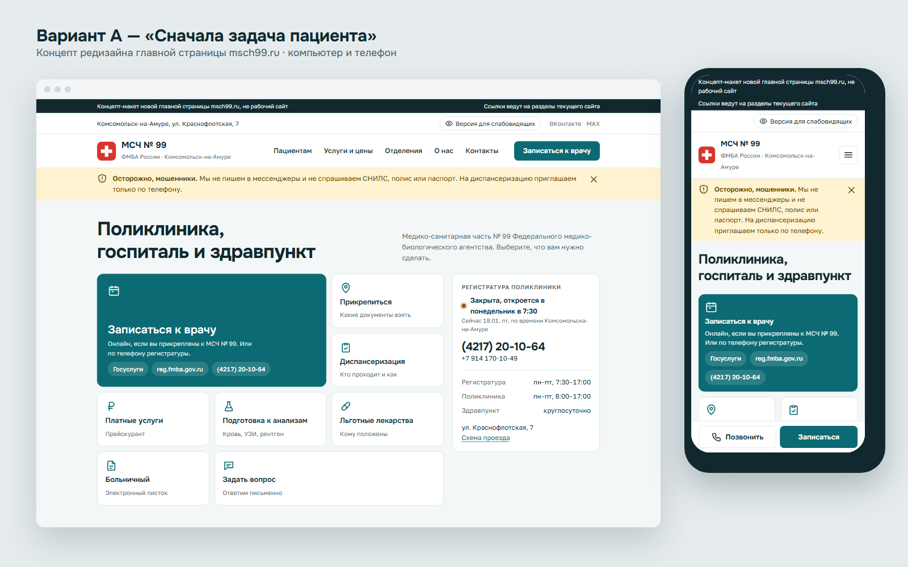
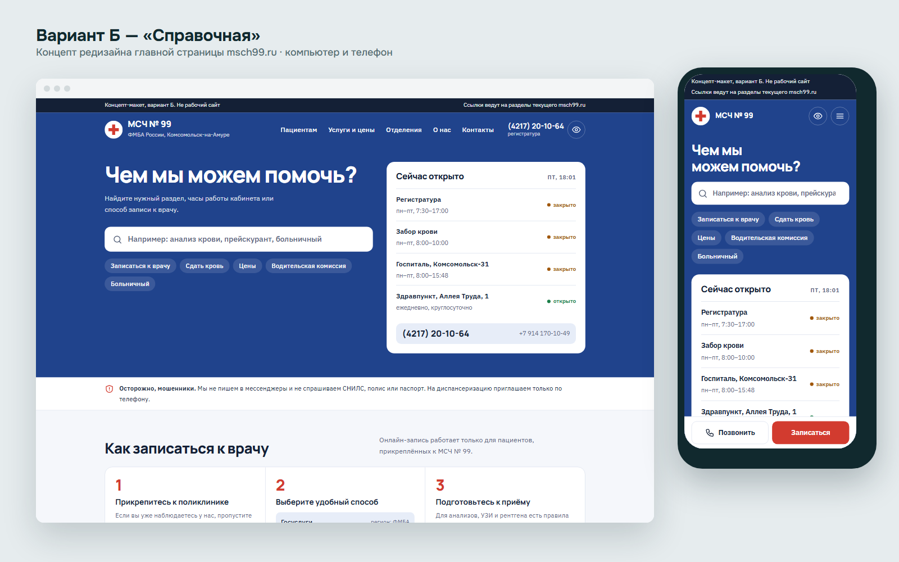

# Редизайн msch99.ru — концепт

Два варианта новой главной страницы сайта МСЧ № 99 ФМБА России (Комсомольск-на-Амуре).
Это макеты для обсуждения, а не рабочий сайт. Официальный сайт учреждения: [msch99.ru](https://msch99.ru/).

## Вариант А — «Сначала задача пациента»

Первый экран состоит из действий: записаться к врачу, прикрепиться, пройти диспансеризацию, узнать цены. Рядом статус регистратуры по местному времени.

## Вариант Б — «Справочная»

В центре поиск по сайту, блок «Сейчас открыто» и ответы на частые вопросы.

## Что меняется

- Мобильная версия и закреплённые кнопки «Позвонить» и «Записаться» на телефоне.
- Запись, телефон регистратуры и часы работы на первом экране.
- Режим для слабовидящих встроен в сайт, а не вынесен на отдельную страницу.
- Объявления сделаны текстом вместо картинок.
- Обязательная информация (документы, лицензия, контролирующие органы) собрана в подвале.

## Как посмотреть

Откройте `index.html` в браузере или включите GitHub Pages: **Settings → Pages → Deploy from a branch → `main` / root**.
Страницы закрыты от индексации (`noindex`), чтобы поисковики не путали макет с официальным сайтом.

## Файлы

| Файл | Что это |
|---|---|
| `index.html` | Витрина с обоими вариантами |
| `variant-a.html` | Вариант А |
| `variant-b.html` | Вариант Б |
| `img/preview-*.png` | Превью: компьютер и телефон |
